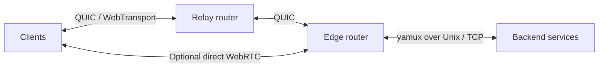

# XConn

XConn builds on [WAMP](https://wamp-proto.org/)’s remote procedure calls and
publish/subscribe messaging, adding byte streams tied to RPCs, service bridging,
and direct WebRTC connectivity.

Built in Rust, it provides one shared implementation with native APIs for Rust,
Go, Python, Dart/Flutter, and browser JavaScript/TypeScript.

Use it to build distributed services, device management, remote tools, or
applications that need both structured messages and continuous data transfer.

## Capabilities

- **RPC and pub/sub:** call procedures across services, publish events, and
  stream progressive call inputs and results.
- **Streams tied to RPCs:** an XConn extension for passing byte streams as
  arguments or results, supporting uploads, downloads, and interactive sessions.
- **Routed and direct connections:** bridge services through routers or connect
  directly over WebRTC, with WAMP-based signaling and trickle ICE.
- **Multiple transports:** WebSocket, RawSocket, QUIC, WebTransport, and yamux,
  with TCP and Unix socket options where applicable.
- **Authentication and codecs:** anonymous, ticket, WAMP-CRA, and cryptosign
  authentication; JSON, CBOR, and MessagePack serialization.

## How it works

A deployment can route traffic through a relay router and an edge router, or use
a direct WebRTC connection to the edge. Backend services stay on their local
connection.



RPCs identify the operation; byte streams travel as its arguments or results.
The same model supports uploads, downloads, and interactive sessions through
compatible routers and bridges. Ordinary WAMP calls and events also work over
WebSocket and RawSocket; byte streams require a stream-capable transport.

## Languages

| Language | Package | APIs |
| --- | --- | --- |
| [Rust](crates/xconn) | [`xconn`](https://crates.io/crates/xconn) | Async and blocking clients and routers |
| [Go](bindings/go) | [`bindings/go`](https://pkg.go.dev/github.com/xconnio/xconn/bindings/go) | Context-aware clients and routers |
| [Python](bindings/python) | [`xconn`](https://pypi.org/project/xconn/) | Blocking and asyncio clients |
| [Dart / Flutter](bindings/dart) | [`xconn`](https://pub.dev/packages/xconn) | Future-based native clients |
| [JavaScript / TypeScript](bindings/js) | [`@xconnio/xconn`](https://www.npmjs.com/package/@xconnio/xconn) | Promise-based browser clients |

Python wheels include the native runtime. Dart downloads it automatically during
builds. Go uses a one-time [native SDK installation](docs/native-install.md).
Browser clients use WASM for the protocol engine and browser APIs for networking.
See the [transport support matrix](bindings/README.md#transport-support) for details.

Follow the language guides above for installation and examples, or run the
[Rust router](crates/xconn/README.md#router-executable).

## Architecture

[`wampproto`](crates/wampproto) is the sans-I/O protocol engine: it handles WAMP
messages and state without sockets or an async runtime. [`xconn`](crates/xconn)
adds networking, sessions, routing, and service bridges. Native bindings share
that Rust runtime; browser bindings pair the protocol engine with browser I/O.

## Development

```sh
cargo fmt --all -- --check
cargo clippy --locked --workspace --all-targets --all-features -- -D warnings
cargo test --locked --workspace --all-features
```

Read more about [RPC byte streams](docs/rpc-streams.md),
[progressive calls](docs/streaming.md), [service bridges](docs/services.md),
and the [project's origins](CONSOLIDATION.md).
